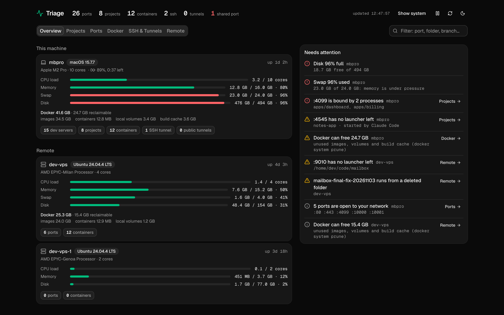
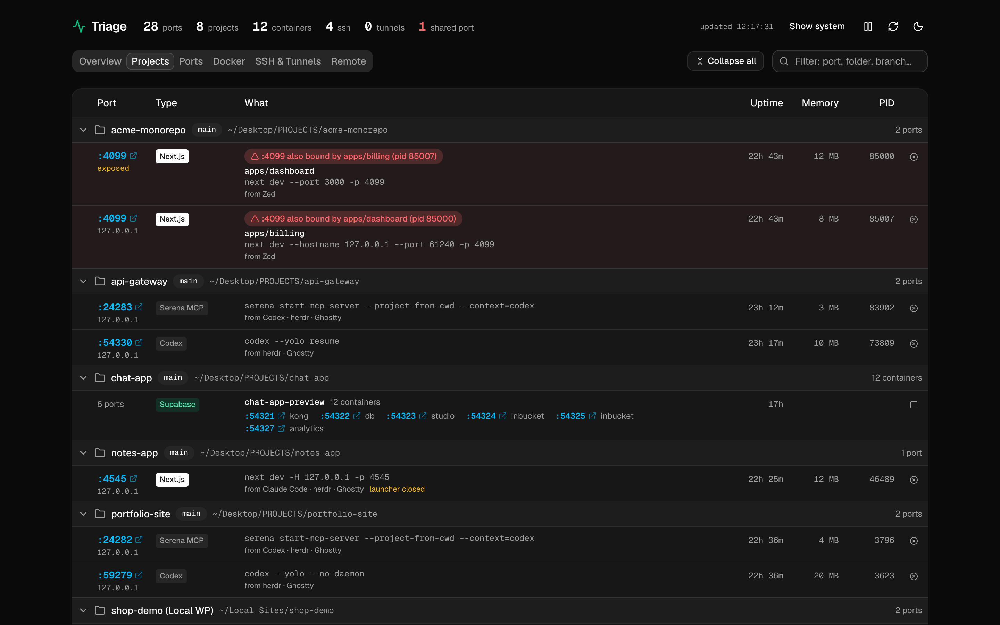
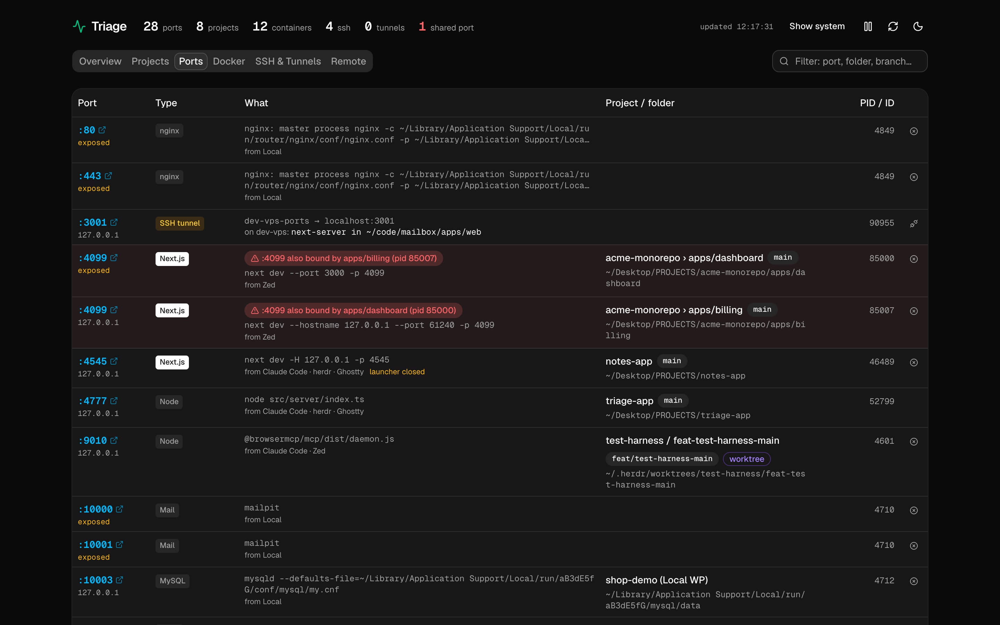
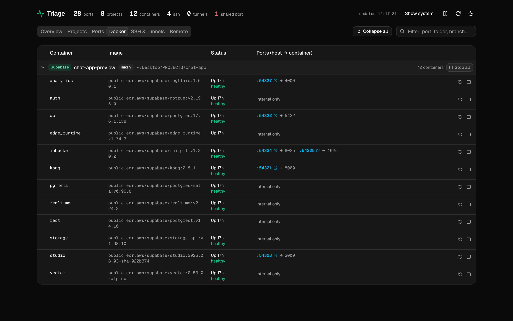
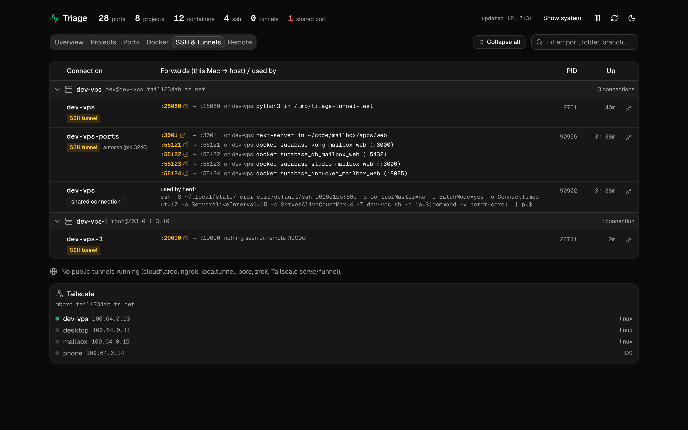
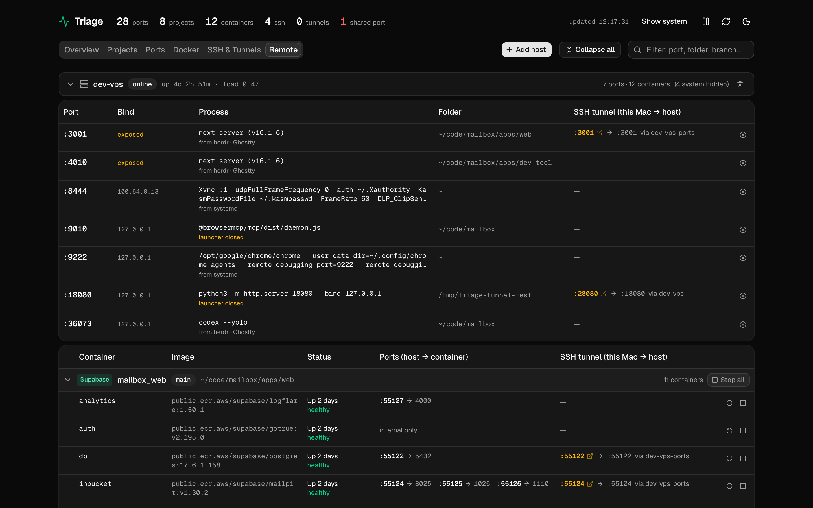

# Triage

<p>
  <a href="LICENSE"></a>
  
  
  
  
  
  
  <a href="https://github.com/sladjanstojcic/triage/commits/main"></a>
</p>

**One local page, or a macOS app, that shows everything running on your Mac and your remote dev servers while you juggle several projects at once.**

Every listening port, dev server, Docker container, SSH tunnel and remote host, grouped by the project folder it belongs to, with who started it and stop buttons that ask before acting.

<picture>
  <source media="(prefers-color-scheme: light)" srcset="docs/screenshots/overview-light.png">
  
</picture>

## Why

When several agents, editors and terminals each start their own `next dev`, `vite`, Supabase stack or SSH tunnel, it gets hard to answer simple questions:

- What is on port 3000, and which project is it?
- Why does my app say the port is in use?
- Which of these servers belong to a terminal I already closed, and which have sat idle for a day?
- If I stop this, what else goes down with it?
- Is that tunnel still connected, and what does it reach on the VPS?
- Why is my disk full? (Docker. It's usually Docker.)

Triage answers them on one page, refreshed every few seconds.

## Features

### Overview

This Mac and every remote host at a glance: CPU load, memory, swap, disk, battery and Docker disk use per machine. A **Needs attention** list flags nearly full disk or swap, ports bound twice, servers whose launcher closed, dev servers left idle for a day, stacks running from deleted folders, unhealthy containers, unreachable hosts, Docker space you can reclaim, and ports open to your network. Each item links to the tab that explains it, and a forgotten or orphaned server can be killed right there.

### Projects

Every listening port grouped by project folder, with git branch, worktree badge and monorepo app (`apps/web`). It warns when two processes bind the same port or a process runs from a deleted folder, and shows who started each server (the agent, editor or terminal, e.g. *from Claude Code · herdr · Ghostty*), with a **launcher closed** mark when nothing that started it is still running. Each project shows what it costs right now: the memory and CPU of its servers, with their workers and watchers, and of its containers.



### Ports

A flat table of every listening TCP port and what owns it: a process, a Docker or Supabase container (mapped through Docker Desktop, OrbStack, Colima or Podman), or an SSH `-L` forward. System services stay hidden until you click **Show system**.



### Docker

Containers grouped by compose or Supabase CLI project, linked to the project folder. Running containers can be restarted or stopped, one at a time or a whole stack at once. Stopped containers stay listed with a start button when their stack is still running or they stopped in the last 24 hours.



### SSH & Tunnels

Outgoing `ssh`/`autossh` connections with their forwards (including ones from `~/.ssh/config`) and what each forward reaches on the other side. Also detects cloudflared, ngrok, localtunnel, bore, zrok, frp, Tailscale serve/funnel, and lists your Tailscale peers.



### Remote

VPS hosts you add by SSH alias, probed every 30 seconds over SSH (`ss`, `/proc`, `df`, `docker ps`, `git`). It uses passwordless `sudo -n` when available, so root-owned services are named too. Containers get the same table as the Docker tab, dev servers can be stopped like local ones, and an SSH tunnel column shows which local port reaches each remote service.



### Stop things safely

Every action asks for confirmation first:

- **✕ kill** a dev server (SIGTERM, or SIGKILL with *Force kill*): the `next dev`/`vite` CLI, not just its worker; also tunnel clients such as `cloudflared` or `ngrok`
- **disconnect** an SSH tunnel: the `autossh` supervisor too, so it doesn't reconnect
- **■ stop**, **▶ start** or **↺ restart** a container, or stop and start a whole compose/Supabase stack

Before a kill or a stop, the confirmation lists what else goes down: the server's other ports and processes, tunnels (cloudflared, ngrok, Tailscale serve) and `ssh -R` forwards that point at it, and local SSH tunnels to a remote service.

This works locally and on remote hosts (over SSH, with `sudo -n` if needed). The server re-checks every target against a fresh scan before acting, and never stops system processes or itself.

## Requirements

- **macOS** (uses `lsof` and `ps`)
- **Node.js 20.19+ (not 21) or 22.12+** (required by Vite 8)
- **pnpm 12** (pinned in `package.json`): `npm install -g pnpm@12`
- Optional: a Docker runtime (Docker Desktop, OrbStack, Colima or Podman), Tailscale, SSH. Anything missing is skipped.
- Desktop app only: Node.js 22.12+ to build it (Electron 45)
- Remote hosts: Linux with `ss`, reachable with key-based SSH auth

## Getting started

```bash
git clone https://github.com/sladjanstojcic/triage.git
cd triage
pnpm install
pnpm dev
```

Open <http://127.0.0.1:4777>. Each tab has its own path (`/overview`, `/projects`, `/ports`, `/docker`, `/ssh`, `/remote`), so a reload stays on it.

| Command | What it does |
| --- | --- |
| `pnpm dev` | Vite + API server with hot reload |
| `pnpm build && pnpm start` | Production build, same address |
| `pnpm desktop` | Build and open the desktop app |
| `pnpm typecheck && pnpm lint && pnpm test` | Checks |

### Keep it running in the background

```bash
pnpm service:install     # build + LaunchAgent: starts at login, restarts if it dies
pnpm service:uninstall
```

Logs go to `~/Library/Logs/triage.log`. Stop `pnpm dev` first, since both use port 4777, and re-run `service:install` after pulling changes.

### Desktop app

Triage also runs as a macOS app: an Electron window around the same server, with the header as its title bar.

```bash
pnpm desktop             # build and open it from the repo
pnpm desktop:package     # build release/mac-arm64/Triage.app; drag it to /Applications
```

The app starts its own server on port 4777, so stop `pnpm dev` or the LaunchAgent (`pnpm service:uninstall`) first. Closing the window keeps it running; quit with ⌘Q. Links to dev servers open in your browser.

The app isn't signed or notarized yet. One you build yourself opens normally; a copy moved to another Mac is blocked the first time; allow it under System Settings → Privacy & Security → Open Anyway.

## Configuration

| Setting | Default | Purpose |
| --- | --- | --- |
| `PORT` | `4777` | Port the server listens on |
| `TRIAGE_HOSTS_FILE` | `~/.config/triage/hosts.json` | Where remote hosts are stored |

Add remote hosts from the **Remote** tab with **Add host**, using an alias from your `~/.ssh/config` or `user@host`.

## Security

Triage shows process command lines and can stop processes, and it has no authentication. So it:

- binds to `127.0.0.1` only
- rejects requests whose `Host` header isn't `127.0.0.1`/`localhost` on its port (DNS rebinding protection)
- accepts state-changing requests (stop, add/remove host) only as JSON from its own page

Don't expose it through a tunnel or reverse proxy.

## Tech stack

React 19, Vite, Tailwind CSS 4 and shadcn/ui (Base UI) in the browser. A small Node HTTP server (`src/server`) collects data with `lsof`, `ps`, `sysctl`, `vm_stat`, `df`, `pmset`, `docker` (including `docker stats` for container CPU and memory), `git`, `ssh` and `tailscale`. The desktop app (`src/desktop`) is Electron, packaged with electron-builder.

## License

[MIT](LICENSE) © 2026 Triage contributors
